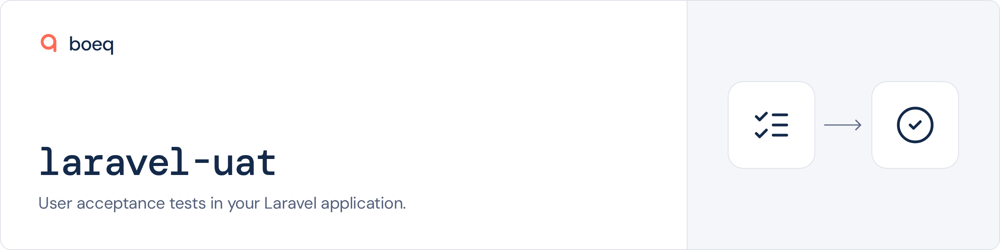
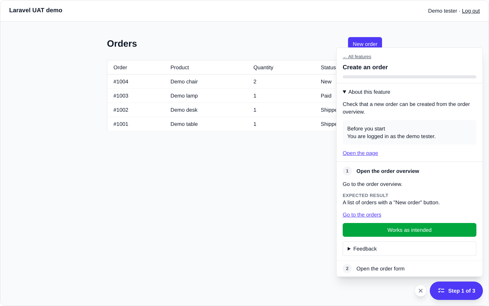
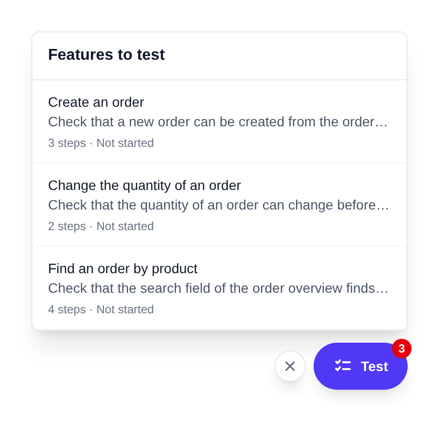
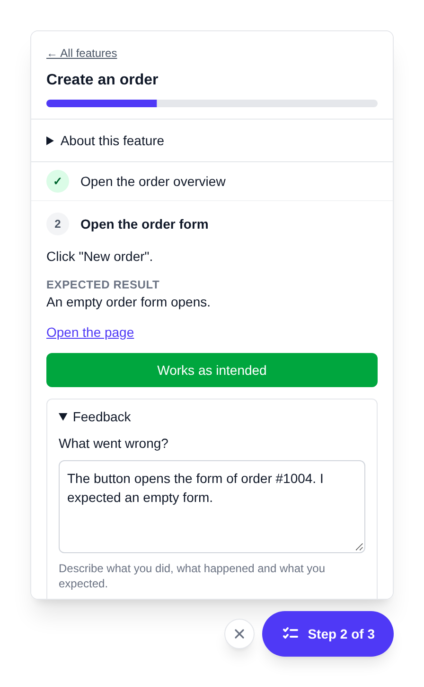
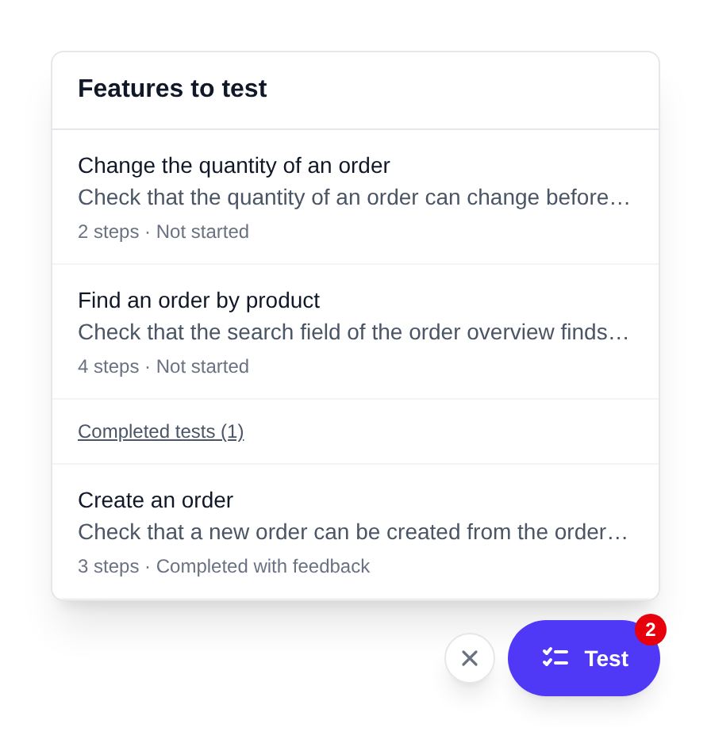
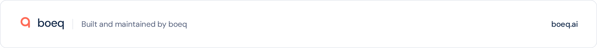

<a href="https://boeq.ai">
  <picture>
    <source media="(prefers-color-scheme: dark)" srcset=".github/assets/header-dark.png">
    
  </picture>
</a>

# laravel-uat

laravel-uat adds a test bubble to your Laravel application. Approved users open the bubble and select a feature. Then they do the test steps on the real pages.

Each step gets a verdict: accepted, or feedback with a description. A developer or an AI agent reads the results through an API.

An AI agent can also write the test steps. The package includes a skill that tells the agent how to do this.

<picture>
  <source media="(prefers-color-scheme: dark)" srcset=".github/assets/screenshot-session-dark.png">
  
</picture>

<p>
  <picture>
    <source media="(prefers-color-scheme: dark)" srcset=".github/assets/screenshot-list-dark.png">
    
  </picture>
  <picture>
    <source media="(prefers-color-scheme: dark)" srcset=".github/assets/screenshot-feedback-dark.png">
    
  </picture>
  <picture>
    <source media="(prefers-color-scheme: dark)" srcset=".github/assets/screenshot-completed-dark.png">
    
  </picture>
</p>

From left to right: the list of scenarios, the feedback for a step, and the completed scenarios of the tester.

```
agent ──HTTPS API──▶ laravel-uat ──bubble──▶ tester
                       │
                       ├─ scenario   steps, expected results, links, translations
                       ├─ session    a copy of the steps, one verdict for each step
                       └─ verdict    accepted · feedback with a description
```

## Quick start

You must have PHP 8.4 or higher, Laravel 12 or 13, and Tailwind CSS 3.4 or higher.

1. Install the package and run the migrations.
2. Tell the package which users can do tests.
3. Add the bubble to your layout.
4. Add the package to the sources of Tailwind.

```bash
composer require boeq/laravel-uat
php artisan migrate
```

Add the `TestsFeatures` contract to your user model. No user sees the bubble before you do this.

```php
use Boeq\Uat\Concerns\TestsAllScenarios;
use Boeq\Uat\Contracts\TestsFeatures;
use Illuminate\Foundation\Auth\User as Authenticatable;

class User extends Authenticatable implements TestsFeatures
{
    use TestsAllScenarios;

    public function canTestFeatures(): bool
    {
        return $this->is_admin;
    }
}
```

Add the component to your layout, immediately before the closing `body` tag:

```blade
<x-uat::bubble />
```

In an Inertia application, add the component to the root Blade template, after `@inertia`.

The bubble uses Tailwind classes. Tailwind must read the views and the configuration of the package.

```css
/* Tailwind 4, in your CSS file */
@source '../../vendor/boeq/laravel-uat/resources/views';
@source '../../vendor/boeq/laravel-uat/config';
```

```js
// Tailwind 3, in tailwind.config.js
content: [
    './vendor/boeq/laravel-uat/resources/views/**/*.blade.php',
    './vendor/boeq/laravel-uat/config/*.php',
],
```

Make a token for the API. Then make the first scenario through the API, or let your agent make it.

```bash
php artisan uat:create-token "Agent" --write
```

If you only want to see the bubble, use `composer serve` in this repository. This command starts a demo application.

## What it does

- It shows a test bubble on each page.
  - Only approved users see the bubble. Guests never see it.
  - The list in the bubble shows the active scenarios that the tester did not complete.
  - A scenario goes out of the list when the tester completes it. A small link below the list shows the completed scenarios of the tester.
  - A badge shows the number of scenarios that the tester did not complete.
  - You can put the bubble in each of the four corners.
- It starts a session immediately when the tester clicks a scenario.
  - There is no screen between the list and the steps.
  - The description and the preconditions are above the steps. They close after the first verdict.
  - The session is a copy of the steps. If you change the scenario later, the copy does not change.
  - The server keeps the session. The tester can stop and then continue on a different page or a different day.
  - A tester has one session in progress at a time. If the tester starts a second scenario, the first session pauses.
- It records one verdict for each step.
  - "Works as intended" accepts the step.
  - "Feedback" is not complete without a description of the problem.
  - Each verdict gets the page URL, the browser, the viewport size, the locale and the time.
  - "Feature works as intended" accepts all steps that have no verdict. Then it completes the session.
  - The tester can change a verdict until the session is complete.
- It shows a scenario in the language of the tester.
  - You set the languages in the configuration.
  - If a scenario has no translation for a language, the bubble shows the default language.
  - A session keeps the language in which it started.
  - You can only activate a scenario that is complete in the default language.
  - The text of the bubble is available in English and Dutch.
- It has an API for scenarios and results. Refer to [The API](#the-api).
  - Each request must have a bearer token.
  - A token can only read, unless you make it with `--write`.
  - The database keeps a hash of the token, not the token.
- It includes a skill for AI agents. Refer to [The agent skill](#the-agent-skill).
- It sends an event when a session starts, when a session is complete, and when feedback arrives or gets a solution. Refer to [Events](#events).

## Who can test

The `TestsFeatures` contract has two methods.

- `canTestFeatures` tells if a user gets the bubble.
- `canTestScenario` tells if a user gets one specific scenario.

The `TestsAllScenarios` trait gives each tester all active scenarios. If you want a different rule, do not use the trait and write the method:

```php
public function canTestScenario(Scenario $scenario): bool
{
    return $this->team->scenario_ids->contains($scenario->id);
}
```

The package does a check of the contract on each request from the bubble. If a user loses access, the bubble goes away on the next request.

To stop the bubble for one environment, set `UAT_ENABLED=false`.

## The API

The API is at `/api/uat/v1`. Send the token as `Authorization: Bearer <token>`.

```bash
php artisan uat:create-token "Agent" --write
php artisan uat:create-token "Dashboard" --expires-at="2027-01-01"
php artisan uat:revoke-token "Agent"
```

The command shows the token one time. Keep it in a safe place.

| Request | Purpose |
|---|---|
| `GET /configuration` | The languages and the default language. |
| `GET /scenarios` | All scenarios, with the number of sessions and the number of open feedback items. |
| `POST /scenarios` | Make a scenario with its steps and its translations. |
| `GET /scenarios/{id}` | One scenario. |
| `PUT /scenarios/{id}` | Replace a scenario. Use this also to change the sequence of the steps. |
| `DELETE /scenarios/{id}` | Delete a scenario that has no sessions. |
| `PUT /scenarios/{id}/translations/{locale}` | Add or replace one language. |
| `PUT /scenarios/{id}/status` | Make a scenario draft, active or archived. |
| `POST /scenarios/{id}/retest` | Tell the testers that the scenario is ready for a new test. |
| `GET /scenarios/{id}/sessions` | The sessions of a scenario. |
| `GET /sessions/{id}` | One session, with each verdict and its data. |
| `GET /feedback` | Open feedback for all scenarios. |
| `POST /feedback/{id}/resolve` | Mark feedback as resolved. You can add a note. |

A scenario starts as a draft. Only active scenarios are in the bubble. You cannot delete a scenario that has sessions, but you can archive it.

For the request bodies and the response bodies, refer to the [API reference](resources/boost/skills/uat-scenarios/references/api.md).

## The agent skill

The skill tells a coding agent how to write a scenario, how to translate it and how to use the feedback. The agent always asks you in which languages it must write.

If you use [Laravel Boost](https://github.com/laravel/boost), `php artisan boost:install` and `php artisan boost:update` offer the skill. If you do not use Boost, publish the skill for Claude Code:

```bash
php artisan vendor:publish --provider="Boeq\Uat\ServiceProvider" --tag="uat-skill"
```

The skill reads two variables from the environment of the agent. The skill does not contain the token.

```bash
UAT_API_URL=https://staging.example.com/api/uat/v1
UAT_API_TOKEN=...
```

## Events

| Event | Sent when | Data |
|---|---|---|
| `SessionStartedEvent` | A tester starts a new session. | `$session` |
| `FeedbackSubmittedEvent` | A tester saves feedback for a step. | `$step` |
| `SessionCompletedEvent` | A tester completes a session. | `$session` |
| `FeedbackResolvedEvent` | Feedback gets the status resolved through the API. | `$step` |

```php
use Boeq\Uat\Events\FeedbackSubmittedEvent;
use Illuminate\Support\Facades\Event;

Event::listen(function (FeedbackSubmittedEvent $event): void {
    // $event->step->feedback, $event->step->page_url, $event->step->session->tester
});
```

## Settings that you will use

Publish the configuration file before you change a setting:

```bash
php artisan vendor:publish --provider="Boeq\Uat\ServiceProvider" --tag="config"
```

| Key | Purpose |
|---|---|
| `enabled` | Set it to `false` to stop the bubble for an environment. The variable is `UAT_ENABLED`. |
| `locales` | The languages in which you write scenarios. The default is `['en']`. |
| `default_locale` | The language that the bubble shows if a translation is missing. |
| `feedback.min_length` | The minimum length of a feedback description. The default is 10 characters. |
| `bubble.position` | The corner of the bubble: `bottom-right`, `bottom-left`, `top-right` or `top-left`. |
| `bubble.classes` | The Tailwind classes for the colours and for the position above other layers. |
| `bubble.links_in_new_tab` | Set it to `true` to open links to your own pages in a new tab. |
| `bubble.prefix`, `bubble.middleware` | The route prefix and the middleware of the bubble. The defaults are `uat` and `web`. |
| `api.enabled` | Set it to `false` to stop the API for an environment. The variable is `UAT_API_ENABLED`. |
| `api.prefix`, `api.middleware` | The route prefix and the middleware of the API. The defaults are `api/uat` and `api`. |
| `table_prefix` | The prefix of the database tables. The default is `uat_`. |

The two middleware lists must do route model binding. The `web` group and the `api` group do this.

If you change `bubble.classes`, make sure that Tailwind also reads your `config/uat.php`.

## How to change the package

Each action has a contract. To replace an action, bind your class to the contract in a service provider:

```php
use App\Actions\CompleteSession;
use Boeq\Uat\Contracts\Sessions\CompletesSession;

public function register(): void
{
    $this->app->singleton(CompletesSession::class, CompleteSession::class);
}
```

```php
namespace App\Actions;

use Boeq\Uat\Actions\Sessions\CompleteSession as BaseCompleteSession;
use Boeq\Uat\Models\Session;

class CompleteSession extends BaseCompleteSession
{
    #[\Override]
    public function complete(Session $session, ?string $closingComment): void
    {
        parent::complete($session, $closingComment);

        // Your own steps.
    }
}
```

To change the views or the text of the bubble, publish them:

```bash
php artisan vendor:publish --provider="Boeq\Uat\ServiceProvider" --tag="views"
php artisan vendor:publish --provider="Boeq\Uat\ServiceProvider" --tag="lang"
```

Publish all views or no views. The views change between releases. If you publish only some views, an update can cause errors.

## What it does not do

- It has no screen for the results. The API and your agent give you the results.
- It does not make screenshots or screen recordings.
- It does not let a person without an account do a test.
- It does not do automatic tests. A person does each step.

## Related packages

- [Laravel Boost](https://github.com/laravel/boost) installs the skill for your agent.
- [spatie/laravel-support-bubble](https://github.com/spatie/laravel-support-bubble) gave the idea for the bubble.

## Development

```bash
composer quality    # code style, static analysis, tests, 100% coverage and Rector
composer serve      # a demo application with one scenario in English and Dutch
```

The demo logs you in as a tester. The API token of the demo is `demo-token`.

Refer to [CONTRIBUTING](.github/CONTRIBUTING.md). To report a security problem, refer to the [security policy](../../security/policy).

## Credits

- [Vincent Boon](https://github.com/VincentBean)
- [All contributors](../../contributors)

## License

MIT. Refer to [LICENSE.md](LICENSE.md).

<a href="https://boeq.ai">
  <picture>
    <source media="(prefers-color-scheme: dark)" srcset=".github/assets/footer-dark.png">
    
  </picture>
</a>
